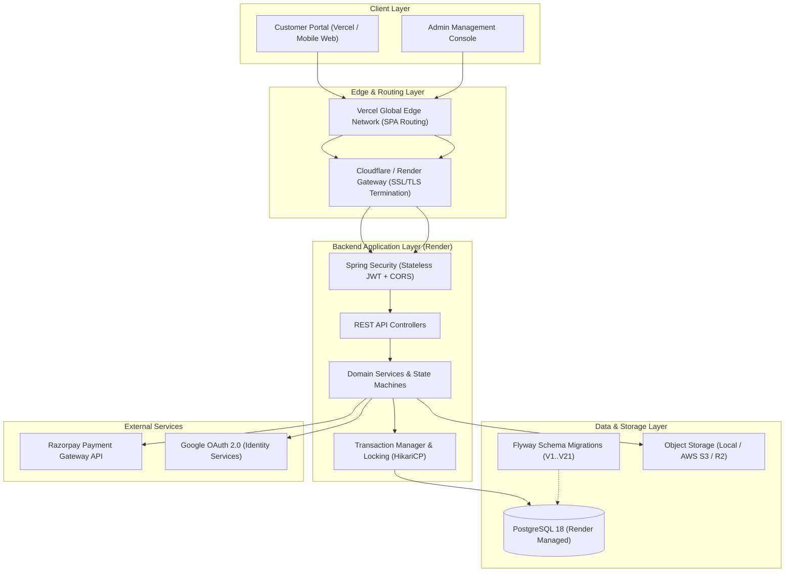

# Architecture Overview — Oorja on Move

## 1. System Context & Overview

**Oorja on Move** is a full-stack, enterprise-grade operations platform for solar plant maintenance, inspection, cleaning, and field technician dispatch. The system provides:
- A responsive, customer-facing web application for service exploration, booking, quotation review, and Razorpay-powered online payments.
- An administrative operations portal for booking dispatch, quotation management, customer audits, refunds, technician tracking, and service report generation.
- A high-throughput Spring Boot REST backend with double-entry payment ledgering, optimistic/pessimistic concurrency controls, and state-machine transitions.

---

## 2. Component Specifications

### 2.1 Frontend Client (`oorja/fe`)
* **Framework & Build:** React 18.3, TypeScript 5.7, Vite 6.
* **Routing:** React Router v7 with single-page application (SPA) client-side routing.
* **Hosting:** Vercel Global Edge Network (`https://oorja-on-move.vercel.app` & `https://fe-nine-sigma.vercel.app`).
* **Routing Rewrites:** Configured via `vercel.json` to route all unmatched requests to `/index.html` with immutable asset caching.
* **State & Data Store:** Lightweight reactive contexts (`AuthContext`, `AuthModalContext`, `AdminAuthContext`) coupled with modular local stores (`continuityStore`, `notificationsStore`).
* **API Client:** Custom typed HTTP layer (`src/lib/api.ts`) featuring automatic header injection, RFC 7807 error unmarshaling, refresh token rotation on 401 Unauthorized, and idempotency key injection (`Idempotency-Key: idemp_<timestamp>_<rand>`).

### 2.2 Backend Application (`oorja/be`)
* **Framework:** Spring Boot 3.3.2 on Java 21 LTS (Temurin distribution).
* **Packaging:** Multi-stage OCI Docker container based on `eclipse-temurin:21-jre-alpine`.
* **Container Execution:** Non-root runtime user (`oorja`) with optimized security parameters (`-Djava.security.egd=file:/dev/./urandom`).
* **Hosting:** Render Web Service (Oregon region) running on port assigned via `${PORT}`.
* **Security & Auth:**
  * Stateless security filter chain (`SecurityConfig`).
  * HS384/HS512 HMAC-signed JWT access tokens (15-minute expiration).
  * Opaque, cryptographically random refresh tokens stored in database with single-use rotation and explicit revocation on logout.
  * Strict origin matching for CORS with wildcard pattern support (`https://*.vercel.app`).

### 2.3 Persistence & Migrations
* **Database:** PostgreSQL 18 managed instance on Render.
* **Connection Pooling:** HikariCP tuned for concurrency (`maximum-pool-size: 30`, `connection-timeout: 10s`, `initialization-fail-timeout: 1`).
* **Schema Evolution:** Managed via Flyway incremental migrations (21 historical migration scripts: `V1__init_schema.sql` through `V21__concurrency_slot_holds.sql`).
* **Integrity Constraints:** Database-level foreign keys, unique indexes (`lower(email)`, `google_id`, `customer_code`), check constraints, and row exclusion rules.

---

## 3. Communication & Protocols

| Interaction | Protocol | Payload / Format | Security |
|---|---|---|---|
| Client $\leftrightarrow$ Backend | HTTPS | JSON (REST API) | Bearer JWT / CORS Origin Validation |
| Backend $\leftrightarrow$ Database | TCP (JDBC) | PostgreSQL Wire Protocol | SSL/TLS, HikariCP Authenticated Pool |
| Backend $\leftrightarrow$ Razorpay | HTTPS | JSON / Webhook Signature | Basic Auth (Key ID + Secret), HMAC SHA256 Webhook Verification |
| Client / Backend $\leftrightarrow$ Google | HTTPS | OpenID Connect / ID Token | Google Identity Services (GIS), Server-side Tokeninfo Verification |
| Storage Access | HTTPS / File I/O | Binary Streams | S3 SigV4 or Restricted Local Filesystem |

---

## 4. Resilience & Scalability Principles

1. **Stateless Compute:** Backend instances maintain zero in-memory session state. All session validity is derived from database-backed token rotation tables and JWT signatures.
2. **Deterministic Locking:** Database-level pessimistic write locks (`SELECT ... FOR UPDATE`) are used for critical resource mutations (OTP consumption, slot reservations, quotation payments).
3. **Graceful Degrades:**
   * When email delivery is unconfigured (`MAIL_ENABLED=false`), OTP tokens securely fallback to system logger.
   * When S3 storage is unconfigured, storage defaults to local scratch disk without failing startup.
