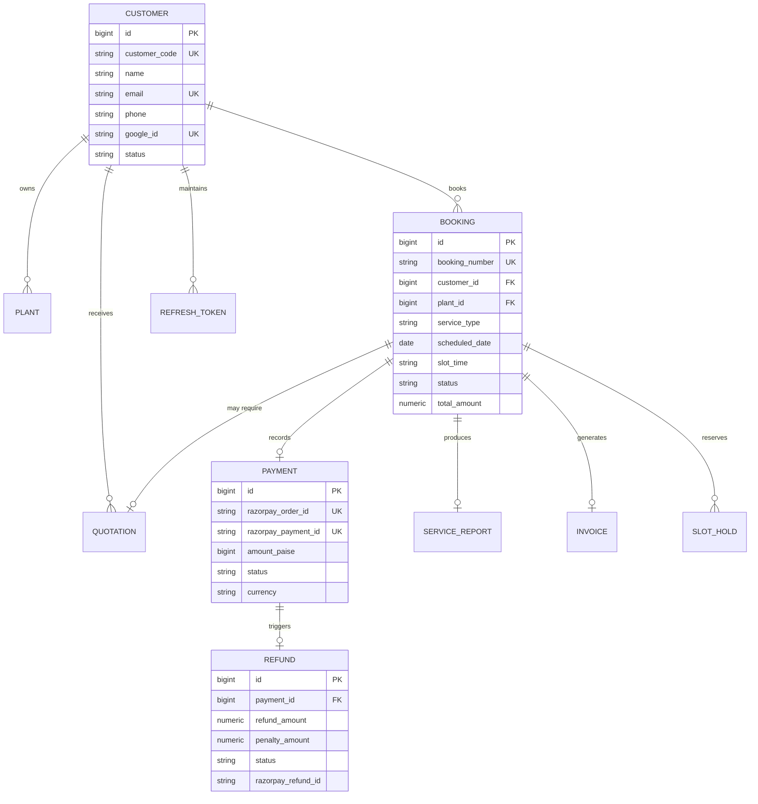

# System Design Specification — Oorja on Move

## 1. Domain Entities & Data Modeling

The system schema models the operational lifecycle of solar plant maintenance from plant onboarding to completion, invoicing, and refunding.



---

## 2. Core Subsystems

### 2.1 Authentication & Token Lifecycle Subsystem
* **Email OTP Authentication:**
  * User requests login or registration code via `/api/customer/auth/login/send-otp`.
  * `OtpService` generates a 6-digit random code, salts/hashes via BCrypt, and records `expiresAt` (+5 minutes).
  * Rate-limited to max 5 requests per 15-minute window per identifier.
  * Verification uses row-level database locking (`FOR UPDATE`) with atomic attempt incrementing to prevent race conditions during verification attempts.
* **Google OAuth 2.0 Identity Federation:**
  * Frontend uses Google Identity Services (GIS) Web SDK to prompt user sign-in.
  * Browser sends Google ID token (`credential`) to `/api/customer/auth/google`.
  * `GoogleAuthService` verifies the JWT signature and audience against Google's `https://oauth2.googleapis.com/tokeninfo`.
  * If verified, customer is loaded by `google_id` or `email`; if not present, a new `Customer` profile is provisioned.
* **Session Issuance:**
  * Issues 15-minute HS512 Access Token carrying `roles`, `customer_id`, and `subject`.
  * Issues 30-day cryptographically random Refresh Token stored in database. On refresh, old token is invalidated (single-use rotation).

---

### 2.2 Booking & Slot Concurrency Engine
* **Slot Hold Management:**
  * When a customer navigates to checkout, a temporary slot hold (`slot_holds`) is established.
  * Prevents double-booking of technician windows across concurrent users.
  * Expired slot holds are automatically bypassed or purged.
* **Booking State Machine:**
  ```
  DRAFT ────────► CONFIRMED ────────► ASSIGNED ────────► IN_PROGRESS ────────► COMPLETED
    │                 │
    └─────────────────┴────────► CANCELLED (triggers Refund Evaluation)
  ```
* **State Transition Rules:**
  * `DRAFT` $\rightarrow$ `CONFIRMED`: Upon successful payment verification or cash-on-service booking creation.
  * `CONFIRMED` $\rightarrow$ `ASSIGNED`: Admin assigns a field technician with available capacity.
  * `ASSIGNED` $\rightarrow$ `IN_PROGRESS`: Technician marks arrival on-site.
  * `IN_PROGRESS` $\rightarrow$ `COMPLETED`: Technician uploads completion checklist and submits service report.

---

### 2.3 Quotation & Custom Pricing Engine
* For complex commercial or utility-scale plants (>20 kW), fixed catalog pricing is replaced by custom on-site engineering quotations.
* **Lifecycle:** `REQUESTED` $\rightarrow$ `ESTIMATED` $\rightarrow$ `SENT` $\rightarrow$ `ACCEPTED` $\rightarrow$ `PAID` (or `EXPIRED`/`REJECTED`).
* When accepted by the customer, payment can be collected directly against the quotation ID via Razorpay order creation.

---

### 2.4 Payment & Refund Ledger
* **Payment Pipeline:**
  1. Frontend calls `/api/customer/payments/create-order` with booking or quotation ID and idempotency key.
  2. Backend interacts with Razorpay Order API with exact paise amount.
  3. Client renders Razorpay Checkout iframe.
  4. Upon callback, frontend passes `razorpay_order_id`, `razorpay_payment_id`, and `razorpay_signature`.
  5. Backend computes HMAC-SHA256 signature and validates against Razorpay Key Secret.
  6. Upon verification, transaction record is committed, booking state transitions to `CONFIRMED`, and an invoice number is generated.
* **Refund Calculation Rules:**
  * **Cancellation > 48h before slot:** 100% refund, 0% cancellation penalty.
  * **Cancellation 24h - 48h before slot:** 80% refund, 20% logistics deduction.
  * **Cancellation < 24h before slot:** 50% refund, 50% technician reservation fee.
  * Refunds are audited through `refund_timelines` tracking step-by-step progress from `REQUESTED` $\rightarrow$ `GATEWAY_INITIATED` $\rightarrow$ `PROCESSED`.
